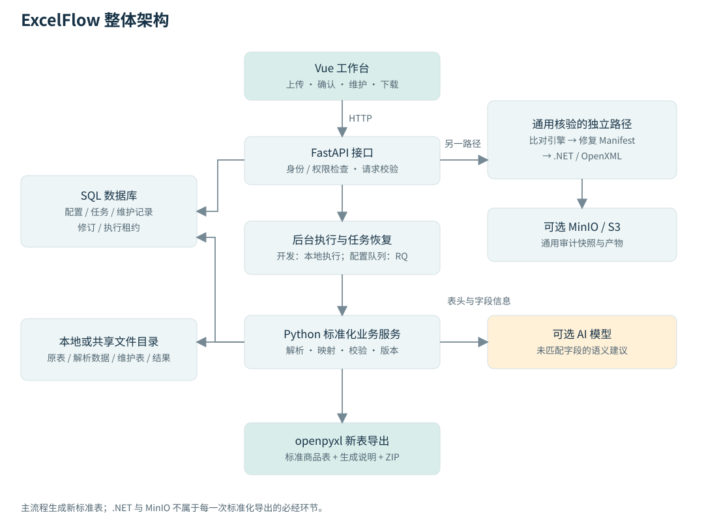
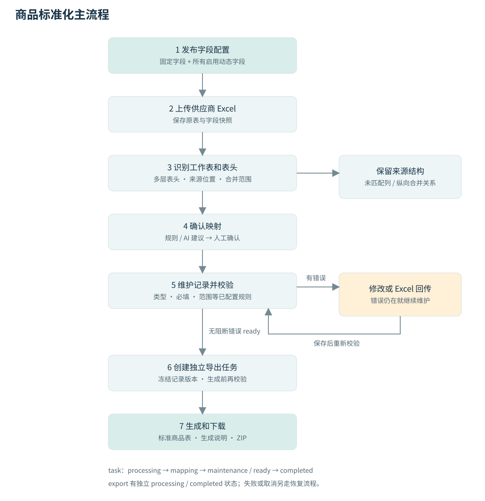
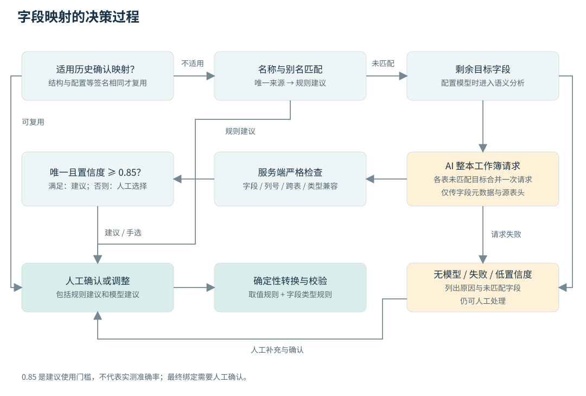

# ExcelFlow 项目讲解与演示讲义

适用日期：2026 年 10 月 26 日，依据当前工作区代码。默认按 20 至 30 分钟技术演示准备，先讲业务闭环，再讲实现。明天需要讲清楚的主线是：**把供应商各不相同的 Excel，变成字段统一、数据经过校验、能追溯来源的标准商品表。**

学习顺序：先读第 1 至 4 部分，建立整体印象；再读第 5 至 7 部分，理解核心实现；最后按第 9 部分演练，用第 10 部分检查是否能独立回答。旁边的 `演示讲义.html` 是可离线打开和打印的阅读版。

## 1 先学会用一分钟介绍项目

可以这样开场：

> 供应商提交的商品表格式经常不一样，同一个字段可能叫“商品名称”，也可能叫“品名”；表里还可能有多层表头、合并单元格、缺失值和不规范价格。ExcelFlow 把这些表接入统一流程：先发布目标字段，再识别原表结构、建议字段对应关系，经过人工确认后进入维护和校验，最后生成标准商品表。系统同时保存字段版本、来源位置和操作记录，方便追溯。

这里有三个要分清的概念：

| 概念 | 它回答的问题 | 示例 |
| --- | --- | --- |
| 字段映射 | 原表哪一列对应标准里的哪个字段？ | 品名 → 商品名称 |
| 数据校验 | 这个字段里的值符合要求吗？ | 价格“待确认”不是有效小数 |
| 标准值比对 | 这条商品的数据和权威记录相同吗？ | 货号 0001 的价格是否等于平台给出的价格 |

**当前商品标准化主流程主要做前两件事。** 第三件事属于平台字段核对或通用核验链路，并且需要真实标准记录作为依据。仅有字段配置，不能证明价格与平台一致。

## 2 整个项目有哪些部分

| 业务链路 | 当前入口或实现 | 输入与输出 | 明天怎么讲 |
| --- | --- | --- | --- |
| 商品标准化 | 默认工作台、字段配置 | 供应商 Excel + 已发布字段 → 标准商品表 | 作为主要演示流程 |
| 旧 SOP | 网页配置和新建入口已移除，保留历史任务兼容 | 历史维护模板 + 输出模板 → 配置化结果 | 被问到时说明兼容能力，无需演示旧配置 |
| 平台字段核对 | 其他工具中的历史平台字段核对 | 接口字段、可选标准记录 + Excel → 问题和报告 | 讲清接口契约与接入状态 |
| 通用标准核验 | 左下角历史核验工具 | 规则版本 + 标准数据 + Excel → 差异报告及受控修复 | 用来解释通用比对与 .NET 渲染 |
| 商品及商家扩展 | `product_workflow`、相关 API | 商品目录、多商家工作表 → 汇总、问题、来源追踪 | 被问到扩展性时再展开 |

上传时可一次多选，或继续追加多个 `.xlsx` 文件：最多 30 个，单个 20 MiB、合计 100 MiB。系统将它们合并为一个任务、统一导出；各文件的同名工作表有独立来源标识，记录可以追溯原文件、工作表和行号。演示时按住 Ctrl 选择不相邻文件，或按住 Shift 选择连续文件。

当前 `App.vue` 默认落到 `#workbench`，新任务统一通过 `/api/v1/standardization-tasks` 创建。`Workbench`、`TaskDetail` 是当前主流程使用的共用组件；旧 SOP 配置入口及模板中心路由已移除，历史任务仍可从处理记录打开。

外部运营平台尚未接入当前标准化流程。字段配置中的本地字段组、商品属性和商品规格是模拟接口字段；任务快照中的 `dynamic_source` 会记录 `local_preview` 或 `not_connected`。另一个平台核对模块已有受管 HTTP 接口适配能力，但“具备适配代码”不等于“当前业务平台联调完成”。

## 3 整体框架图

把系统想成一个加工车间：前端是操作台，API 是接单和检查身份的窗口，任务队列负责排队，Worker 负责加工，数据库保存任务进度与记录，文件目录保存原表和产物。规则与 AI 各负责不同的判断。

| 模块 | 职责 | 为什么需要 |
| --- | --- | --- |
| Vue 3 + TypeScript + Vite | 上传、映射确认、在线维护、进度和下载 | 把处理流程变成运营能使用的页面 |
| FastAPI | 接收请求、检查权限、调用服务、返回状态 | 统一业务接口 |
| Python 工作流服务 | 解析、字段映射、校验、版本控制、导出编排 | 承载业务逻辑 |
| openpyxl | 读取工作簿、生成维护表和标准商品表 | 处理主流程中的 Excel 数据与布局 |
| AI 接口 | 为未匹配表头提供语义建议 | 处理“叫法不同但含义相同”的情况 |
| PostgreSQL / SQLite | 保存配置、任务、维护记录、修订和执行记录 | 刷新页面或重启后仍能恢复状态 |
| Redis + RQ | 将后台任务交给 Worker | 上传请求不必等待全部处理完成 |
| 本地或共享文件目录 | 保存工作流原表、解析数据、维护表和导出文件 | 大文件与业务元数据分开管理 |
| MinIO / S3 | 通用审计服务可配置的产物与快照存储 | 支持对象存储部署；不能说所有 SOP 文件都在 MinIO |
| .NET 8 + OpenXML | 通用核验链路的高保真受控修复 | 操作已有工作簿时尽量保持受支持结构 |

开发环境可以用 SQLite 和本地后台执行；配置 Redis 后通过 RQ 调度。生产组合包括 PostgreSQL、Redis/RQ、共享数据卷和可配置的对象存储。实际启用了哪套组件，要看启动配置，不能把架构图上的可选项都说成现场正在运行。

**关键边界：标准化导出直接走 `workflow/excel.py` 的 `write_output`，并不调用 .NET。** .NET 的作用在通用核验里：Python 先决定允许改什么，再由渲染器执行修复计划。

## 4 从上传到导出的完整流程

### 4.1 发布目标字段

管理员维护字段名称、稳定 ID、类型、别名、必填、默认值和范围等。草稿保存后，需要发布才能用于新任务。`compile_profile` 将固定字段与所有启用的动态字段编译成统一的 `WorkflowConfig`。

这里“编译”只是把页面配置转换为程序能执行的统一结构。维护表的字段顺序是：**固定字段 → 全部商品属性 → 全部商品规格 → 当前任务的原表保留列**。最终导出时，商品属性和商品规格分别汇总为一列，按“字段名：值”排列，例如 `品牌：三雄极光、系列：、名称：防眩筒灯`，使用运营维护回传并确认后的最新值。字段组用于组织和区分字段，不按供应商工作表名筛选动态字段。因此把某个动态字段设为必填，会影响使用这一统一结构的记录，演示前应检查是否符合业务。

### 4.2 上传并冻结配置

前端上传文件，调用 `POST /api/v1/standardization-tasks`。服务读取已发布配置，将完整字段定义、版本、摘要存入任务，同时保存原始文件。接口返回 202，表示任务已接受，处理仍在后台进行。

可以这样解释快照：**任务开工时给规则拍一张照片，以后按这张照片加工。** 后续发布新配置影响新任务，不会把正在维护的任务悄悄换成新结构。

### 4.3 识别表结构

`discover` 读取可见工作表，找实际数据区域，尝试定位表头和多层表头，展开合并单元格的值用于逐行处理，同时保留原合并范围。程序记录工作表名、来源行、列位置和预览。

表头候选来自前 50 行，评分包含已知字段匹配数和文本标签数；模板模式还考虑合并表头结构。它属于可解释的启发式识别，不保证任何表都能自动识别正确，所以页面允许确认表头位置。

### 4.4 建议并确认字段映射

系统优先尝试适用的历史人工确认映射，然后进行名称或别名匹配；仍未匹配的目标字段在配置了模型时交给 AI。用户确认最终取值规则，服务端再验证字段、源列和目标是否有效。

“品名 → 商品名称”只是列与字段建立对应关系，此时还不能说明每行商品名称有效，也不能说明其他价格字段已校验通过。

### 4.5 生成维护记录并校验

确认映射后，系统按取值规则把原表行转换成内部记录。每条记录包含稳定记录 ID、字段值、最初导入值、来源位置和问题列表。没有映射上的原列进入任务内保留区，明确的“序号”“行号”通常被排除，货号或商品编码照常保留。

字段类型解析与规则校验随后执行。有阻断错误进入 `maintenance`；无阻断错误进入 `ready`。两种状态都可以在维护界面查看数据，`ready` 表示具备导出条件。

### 4.6 在线修改或 Excel 回传

在线修改提交的是“记录 ID → 字段 ID → 新值”，不是整张文件替换。保存会重新校验，并增加业务修订号。也可下载系统生成的维护表，在 Excel 里修改后回传，先预览差异再应用。 网页下载的维护表保留固定字段、动态字段和来源分组的多层表头及原有共享单元格关系，支持新增空 ID 行和删除商品行；含合并单元格时优先在网页筛选、排序，不能只移动业务列。回传预览同时展示新增、修改与缺少明细，删除默认不执行；发现疑似 ID 丢失或业务列单独排序时，须核对并额外确认。

### 4.7 导出与下载

导出前再次检查阻断错误，冻结当前记录和配置，创建独立导出任务。后台用 openpyxl 写出 `标准商品表.xlsx`，并生成 `生成说明.json` 与 `最终表.zip`。完成后发布产物；如果维护数据已经产生新修订，旧导出不会把新修订错误标成已完成。

用户看到的简化状态链为：`processing → mapping → maintenance 或 ready → completed`。**导出过程有独立 export 对象的 processing/completed 状态，主 task 不一定在此时变成 processing。** 面试被问到状态机时要区分这两层。

## 5 用一张真实演示小表串起来

本讲义附带的原表来自项目既有的本地模拟数据，共三条记录，不是实际客户数据。

| 货号 | 品名 | 含税价格 | 用料 |
| --- | --- | --- | --- |
| 0001 | 阅读台灯 | 129.50 | 铝合金 |
| 0002 | 桌面收纳盒 | 待确认 | 木质 |
| 0003 | 置物架 | 79.00 | 钢制 |

本次隔离演练的目标结构是：商品名称（别名“品名”，必填）、商品编码（别名“货号”，类型 `id_code`）、销售价（别名“含税价格”，类型 `decimal`，最小值 0）。刻意没有配置“用料”，用于展示未匹配列的保留。

处理结果如下：

1. 三个别名直接匹配，原表无需 AI 也能建立这三条对应关系。
2. `0001` 是标识符，仍然保留前导零，不能当整数 1 处理。
3. `129.50` 按 Decimal 解析；导出的数值可能显示为 `129.5`，显示格式与数值含义是两件事。
4. “待确认”不能按小数解析，第二条记录被标为阻断错误，导出请求被拒绝。
5. 在演练中，模拟运营明确将第二条价格改为 `99.00`。这个数值只是教学假设，不是 AI 推断，也不是平台价格。
6. 保存后错误清除，进入 ready；“用料”作为原表保留列追加到右侧。
7. 导出得到一个“标准商品”工作表，三条商品记录、四列数据，任务完成。

| 商品名称 | 商品编码 | 销售价 | 用料（原表保留列） |
| --- | --- | --- | --- |
| 阅读台灯 | 0001 | 129.5 | 铝合金 |
| 桌面收纳盒 | 0002 | 99 | 木质 |
| 置物架 | 0003 | 79 | 钢制 |

演练已经直接调用实际 Python 服务完成创建、解析、确认、拒绝错误导出、修改、维护表回读预览和导出，并回读检查了结果。它验证的是隔离服务流程；真实模型、网页点击和生产基础设施需要现场环境另行彩排。

文件位置：`outputs/demo-training-20261026/演示供应商原表.xlsx` 与 `演示标准商品表.xlsx`。附带的 `隔离任务维护表.xlsx` 属于已结束的隔离任务，仅用于观察元数据结构；**网页演示回传时必须下载网页当前任务的维护表，不能上传这份隔离文件。**

## 6 核心实现原理

### 6.1 字段映射为什么采用规则加 AI 加人工

名称或别名一致时，规则匹配快速、可解释、结果稳定。例如提前配置“货号”为商品编码的别名，每次就能识别。当前新流程主要用精确名称与别名匹配加模型语义建议；RapidFuzz 在通用核验和其他商品匹配模块中也有使用，不应把所有识别统一说成模糊字符串匹配。

AI 处理的是“含义相近但规则没覆盖”的列名。例如目标字段叫“材质”，供应商写“用料”。主流程送给模型的是字段 ID、名称、说明、别名、类型以及源列号和表头，**不发送商品行值**。本地网页虽然展示了示例值，不能据此推断示例也发给模型。

模型返回结构化映射：目标字段 ID、来源列、置信度和理由。服务端拒绝未知字段、非法列、跨表对应和重复目标。唯一且置信度至少 0.85 的候选，还要经过本地来源类型兼容检查，才能加入待确认建议；低置信度留给人工处理。0.85 是模型自报分数的使用门槛，不能说成“实际准确率 85%”。

当前源码将工作簿各表未匹配的目标字段及表头合并为一次模型请求；不同表通过 sheet_id 和带作用域的字段 ID 区分，返回后还原本表列号，禁止跨表绑定。通用请求执行器仍保留并发、短时缓存与在途请求复用；配置 Redis 后还存在共享缓存路径。超时或临时服务错误可以重试一次，格式或认证问题不盲目重试。模型失败时保留已有精确匹配，并显示未完成的分析。

本地类型兼容检查不会把商品行发给模型：对数值、日期、布尔、枚举等字段，如果候选源列的非空有效数据全部不能按目标类型解析，就拒绝这个语义建议。如果一列既有合法值又有非法值，则允许进入维护流程，再逐条报告问题；这不是全面的数据质量验收。

最新代码还包含 `ConfirmedMappings`：人工确认后，在工作空间、操作者、模型配置、表结构和目标字段等签名相同的条件下，可复用之前确认的映射。它缓存的是映射规则，不是训练模型，也不保存商品行内容作为模型记忆。该实现可在 `mapping_memory.py` 查看。

没有配置模型或模型调用失败时，同名/别名匹配和人工确认仍然可用；未匹配字段与失败原因会明确显示。未匹配字段多，并不必然意味着模型服务报错。

### 6.2 类型化校验为什么比字符串比较可靠

字符串“129.50”和“129.5”写法不同，数值可能相等；商品编码“0001”和“1”却可能是不同商品。因此必须先知道字段类型，再解析或比较。

`parse_value` 负责类型化处理，`validate_records` 根据配置检查必填、类型、范围等规则。校验引擎还支持唯一键和跨字段检查，但只有相应工作流配置启用时才生效，不能说每个新标准化任务都自动带有全部业务规则。

价格使用 Decimal，避免二进制浮点直接用于精确十进制业务判断。源标识符通过 `id_code` 保持标识含义。单位换算使用显式取值操作，例如把“万元”乘以 10000 转成“元”，不能把不明单位自动猜成一致。

取值操作包括直接复制、去空格、固定值、拼接、拆分和数值乘系数。一个源列可以填多个不同目标；同一目标不能同时被两个独立来源绑定，应该明确选择来源或使用拼接规则。

### 6.3 原表保留列如何避免漏数据

标准结构无法覆盖供应商每个字段。确认映射时，程序计算哪些来源列已被使用，其余列根据“来源工作表 + 列位置”产生稳定 ID，追加到当前任务字段和输出中。

这比按列名识别更可靠：两个不同表都有“备注”，也不会混成同一列。保留列按文本传递，不套用标准字段的 trim 和类型规范化，尽量保留空格、前导零与多行内容。它们不进入全局字段配置。

“完整保留”有明确范围：用户排除的整张工作表不导入，明确序号列被排除，复杂公式需要先粘贴成值，输出生成新表而非复制原文件全部图片、宏和布局。演示时应说“保留未匹配来源列及其值”，避免说“完整无损复制任何 Excel”。

### 6.4 合并单元格为什么仍能逐行维护

例如原表商品名称 A2:A3 合并为“外开窗”，两行分别记录“固定位”和“开启扇”的价格。系统逻辑层仍保留两条明细，只为共享名称记录同一来源合并标记。

展示、维护下载和导出时，只有“同一原始合并范围 + 当前相邻 + 值相同”才合并。两个独立商品恰巧同名不会因此合并。没有来源的新增字段，可以按真实来源合并边界形成共享行块；跨业务列的横向合并不会机械照搬。

编辑共享单元格时，`expand_shared_changes` 将修改扩展到同一来源分组内的相关记录，并检查冲突。底层逐行存储、界面共享展示，是这里最重要的设计。

### 6.5 Excel 回传怎么知道改了哪条记录

维护文件的隐藏列 `_workflow_record_id` 标识每条记录；隐藏工作表 `_workflow_meta` 保存任务 ID、修订号、字段 ID 列表和配置摘要。回传时系统同时验证任务归属、版本、表头结构和合并关系，再按记录 ID 对齐差异。

因此系统不是简单地“Excel 第 5 行覆盖数据库第 5 行”。旧维护表会因修订过期被拒绝；改错任务或随意删改表头也会被拒绝。回传先预览改动、新增、缺失记录，再应用，删除缺失行需要明确选择。

隐藏元数据用于定位和校验，不是加密，也不能单独代替服务端鉴权。最终权限仍由 API、任务归属和当前状态判断。

### 6.6 并发操作如何避免互相覆盖

这里有三种不同的保障：

| 机制 | 防止的问题 | 通俗例子 |
| --- | --- | --- |
| revision 乐观锁 | 旧页面覆盖新保存 | A、B 都看到第 5 版；A 存成第 6 版后，B 的第 5 版提交被拒绝 |
| Idempotency-Key 幂等键 | 网络重试创建重复任务 | 同一个上传请求重试时返回原任务；相同键但输入不同则冲突 |
| 执行租约、心跳和 token | 失效 Worker 写回旧结果 | Worker 失去有效执行权后，保存结果会被 fence 检查拒绝 |

`WorkflowStore.claim` 用“ID、工作空间、当前 revision 匹配”的条件更新保证修订检查与写入原子发生。`workflow_executions` 保存持久执行记录，任务对象与待执行记录在事务内产生；恢复扫描负责重新分发符合条件的任务。它提高异常恢复能力，不代表任意业务错误都能自动修好。

导出数据另有快照：导出开始后即使用户继续修改维护数据，本次产物仍对应发起时的记录版本，不混入一半旧、一半新的数据。

### 6.7 鉴权和追溯如何实现

当前网页登录采用管理员账号密码与 HttpOnly 会话 Cookie，生产 Cookie 还设置 Secure，写操作有来源及 CSRF 相关检查。服务接口仍兼容 Bearer 身份。代码保留工作空间和角色权限能力，但不要将当前单管理员网页入口演示成已经开放的多用户注册系统。

数据库保存任务创建者、来源行、字段映射和操作修订。来源行回答“从哪里来”，映射回答“如何转换”，修订回答“哪次操作改过什么”。只有记录这些信息，排查“为什么价格错了”时才能顺着链路找到原因。

## 7 进阶架构与代码定位

| 你要解释的行为 | 对应代码及主要符号 |
| --- | --- |
| 当前网页入口和菜单 | [App.vue](../../apps/web/src/App.vue) |
| 前端上传、确认、维护、导出 | [Workbench.vue](../../apps/web/src/workflow/Workbench.vue)、[TaskDetail.vue](../../apps/web/src/workflow/TaskDetail.vue)、[api.ts](../../apps/web/src/workflow/api.ts) |
| 应用装配 | [api.py](../../src/excel_auditor/api.py) |
| API 接口与后台调度 | [workflow/routes.py](../../src/excel_auditor/workflow/routes.py) |
| 字段编译与发布快照 | [field_profiles.py](../../src/excel_auditor/workflow/field_profiles.py)：`compile_profile`、`snapshot` |
| 主流程编排 | [tasks.py](../../src/excel_auditor/workflow/tasks.py)：`create_standardization`、`parse`、`confirm_mapping`、`edit`、`create_export`、`generate` |
| 工作簿解析与校验 | [excel.py](../../src/excel_auditor/workflow/excel.py)：`discover`、`transform`、`validate_records` |
| 维护回传与新表输出 | 同一 `excel.py`：`write_maintenance`、`read_maintenance`、`write_output` |
| 字段匹配与模型响应校验 | [semantic_mapping.py](../../src/excel_auditor/workflow/semantic_mapping.py)、[ai.py](../../src/excel_auditor/workflow/ai.py) |
| 并发和缓存 | [mapping_runtime.py](../../src/excel_auditor/workflow/mapping_runtime.py) |
| 人工确认映射复用 | [mapping_memory.py](../../src/excel_auditor/workflow/mapping_memory.py) |
| 原列和合并关系 | [retained_columns.py](../../src/excel_auditor/workflow/retained_columns.py)、[source_merges.py](../../src/excel_auditor/workflow/source_merges.py) |
| 持久化、乐观锁、执行恢复 | [repository.py](../../src/excel_auditor/workflow/repository.py)、[execution.py](../../src/excel_auditor/workflow/execution.py) |
| 通用比对与渲染 | [engine.py](../../src/excel_auditor/engine.py)、[service.py](../../src/excel_auditor/service.py)、[rendering.py](../../src/excel_auditor/rendering.py)、[Program.cs](../../services/excel_renderer/Program.cs) |

不用背整套源码。优先沿着 `routes.create_standardization → TaskService.create_standardization → parse → confirm_mapping → edit → create_export → generate → write_output` 看一遍，就能把按钮与后端行为连上。

核心数据表的分工：`workflow_objects` 保存配置、任务、导出等对象的状态和 JSON 配置；`workflow_records` 保存逐条维护数据、来源和问题；`workflow_revisions` 保存操作审计；`workflow_executions` 保存后台执行状态、尝试次数、token 和租约。

浏览器页面定时查询状态和进度，不能把这个实现说成 WebSocket 实时推送。进度来自真实处理阶段和模型请求返回状态；当前整本工作簿可以显示为一批，不能把它解释成逐字段完成百分比或准确的剩余时间预测。

## 8 其他核验链路如何工作

通用核验可概括为：**版本化规则 → 工作簿安全预检 → 固化标准数据快照 → 表头映射 → 按主键对齐记录 → 类型化比较 → 差异与修复计划 → 渲染和报告。**

主键用于确定“哪两条记录是一件东西”。例如用 SKU 将供应商表中的 0001 与标准记录的 0001 对齐，再比较价格。按行号直接比较会因排序变化产生误报；空主键和重复主键需要隔离，因为无法可靠地一一对齐。标准数据快照及 SHA-256 校验保证此次比较使用的数据版本可追溯，并帮助发现内容变化；哈希本身不证明标准数据来自可信业务源。

修复计划也称 Manifest，是结构化操作清单。例如哪个单元格标记、哪个缺失字段允许填值、哪个位置允许插列。Python 负责决定差异和授权范围，渲染器执行操作并报告结果。对于不支持或不能证明安全的结构，流程会报告问题、转人工，或仅输出报告；不能承诺所有 Excel 都自动修复。

平台字段核对模块从受管接口读取字段定义，可选读取标准记录。如果接口只有 fields，就做字段对应和必填、类型、枚举检查；只有还提供 primary_key 和 records，才具备逐行核对标准值的依据。该链路中的文本语义值比较另有明确授权和敏感字段限制，不要把“标准化映射不发送行值”扩大成“项目任何功能永不发送字段值”。

商品及商家扩展还支持表识别、商品名称候选匹配、汇总表、问题表和来源追踪。它与当前主流程中的“列名对应关系”不是同一层匹配：前者可能是在匹配商品记录，后者是在匹配字段。

## 9 明天的演示顺序和话术

| 时间 | 操作 | 可以直接说的话 |
| --- | --- | --- |
| 0 至 2 分钟 | 展示原表 | 供应商的字段叫法、顺序和数据质量不一致，人工整理容易漏列和改错。 |
| 2 至 4 分钟 | 展示整体架构图 | 页面负责操作，后端组织处理；规则、模型和人工分别承担不同判断。 |
| 4 至 6 分钟 | 打开字段配置，查看已发布版本 | 我们先定义目标表，而不是要求所有供应商重做原表；新任务会冻结这个版本。 |
| 6 至 9 分钟 | 上传已彩排过的原表，查看解析与映射 | 系统先识别结构并给出对应关系；同名和别名直接匹配，其他字段可以由模型建议。 |
| 9 至 12 分钟 | 确认映射，展示维护页问题 | 字段对应完成后还要逐条校验，价格里的“待确认”不能当成数字。 |
| 12 至 14 分钟 | 明确输入演示价格并保存 | 这里是运营给出修正值，系统负责验证；没有证据就不会猜测真实价格。 |
| 14 至 17 分钟 | 下载当前任务维护表，修改一处，再回传预览 | 通过记录 ID 和版本识别变更，避免错行和旧文件覆盖。 |
| 17 至 20 分钟 | 导出并打开结果 | 输出列顺序统一，未匹配来源列保留，编码前导零保持。 |
| 20 至 25 分钟 | 回到核心实现图，回答问题 | 核心价值是把识别、确认、校验和可追溯导出连成可重复流程。 |

如果只有 10 分钟：保留原表、字段配置、映射、错误修正和导出五步，Excel 回传与旧核验工具只口述。不要为了展示全部菜单打断主线。

### 今晚的彩排

1. 用明天实际使用的账号和浏览器打开项目，确认能登录、能读取字段配置、能上传和下载。已存在的监听端口不等于现场流程验收通过。
2. 核对实际配置的字段名称、别名和必填要求。附带小表使用的是讲义中的精简演练配置；如果网页配置有更多必填字段，需要补充数据，不能保证直接照搬就只出现一个价格错误。准备专用演示配置时先确认不会影响其他新任务。
3. 为正式演示选定一张已经跑过全流程的文件。核对数据条数、输出列、保留列和合并关系，保留完整结果作为现场备用。
4. 如需展示 AI，提前确认模型地址、配置和额度；不要把实时模型响应速度作为整场演示的依赖。可用既有别名或人工选择继续讲完整闭环。
5. 回传只用现场任务刚下载的维护表。不改隐藏列、表头和合并关系；先看预览，再确认应用。
6. 原表中的真实公式应提前粘贴为值。主流程单文件上传上限为 20 MiB，每批最多 30 个文件、合计 100 MiB，批次记录上限 20,000，维护区域受 200 万单元格约束；不要现场临时换未经验证的大文件。

### 常见现场状况

| 状况 | 怎么处理和解释 |
| --- | --- |
| 模型慢或未配置 | 展示规则匹配和人工确认，说明 AI 属于辅助识别环节 |
| 没有输出按钮或生成被阻断 | 检查维护表错误数和任务状态，先处理真实错误 |
| 回传提示版本过期 | 重新下载当前任务维护表；解释这是防止旧数据覆盖的保护 |
| 导出时新改动未出现在旧文件 | 说明导出冻结发起时的数据版本，再生成新版本 |
| 被问真实平台接入 | 说明当前标准化动态字段是本地模拟，接口适配与实际联调分别介绍 |
| 网络或服务故障 | 使用提前保存的原表、结果与图讲解，不把静态文件说成实时运行结果 |

## 10 答辩题与参考答案

先合上答案，用自己的话回答。每题能说出“为什么、怎么做、有什么边界”就算理解了。

**1. 这个项目和普通 Excel 转换脚本有什么区别？**

转换只是其中一步。项目还提供字段版本、人工映射确认、维护校验、回传、任务执行、权限和审计，将一次性转换变成可管理的业务流程。

**2. 为什么不用 AI 直接生成整张标准表？**

字段理解有不确定性，价格和编码需要确定性处理。项目让 AI 给出表头语义候选，服务端检查格式与引用范围，人工确认后由规则处理数据，减少不可解释的修改。

**3. 0.85 是什么意思？是不是准确率 85%？**

它是模型返回置信度的建议采纳门槛，不是经过统计验证的实际准确率。达到门槛也仍然是待人工确认的绑定建议。

**4. 为什么上传后马上就返回，文件还在处理？**

创建接口返回已接受状态，再由持久执行记录与后台调度完成耗时处理。页面通过查询任务状态显示进度，避免上传请求一直等待。

**5. 发布新字段后，旧任务会变吗？**

不会自动换成新发布配置。任务保存自己的字段快照。需要修改结构时应走明确的重分析或新任务流程，并理解重建映射可能清空已有维护修改。

**6. 同名列和多层表头怎么处理？**

识别表头层级后形成完整字段路径，并保留列位置。同名但多个候选需要人工消歧，不能仅凭“都叫备注”就认作同一来源。

**7. 原表有不认识的列怎么办？**

新标准化任务将未匹配列追加为当前任务的原表保留列，按来源表和列位置识别。它们不污染全局字段配置，明确排除的工作表和序号列另按规则处理。

**8. 两个人同时修改怎么办？**

提交时带 base_revision。数据库只接受仍匹配当前修订的操作，旧修订返回冲突；这避免“最后保存者覆盖前一个人的修改”。当前网页展示单管理员，但多页面并发同样需要这个保护。

**9. 工作进程崩溃会怎样？**

持久执行记录、租约、心跳和恢复扫描提供重新调度依据，失效执行的 token 不能写回结果。可重试故障和业务格式错误分别处理，不能说任何错误都无限重试。

**10. 为什么需要 .NET？当前标准表是它生成的吗？**

当前标准化结果用 openpyxl 生成。.NET/OpenXML 用于通用核验中对已有工作簿做受控修复，按 Manifest 执行支持的结构修改；它不在每个导出路径中。

**11. 怎么保证标准数据没有中途变化？**

标准化任务冻结字段配置，导出冻结维护数据；通用核验另外固化标准数据快照并校验哈希。三种快照解决的版本问题不同，不要混为一个东西。

**12. 价格通过校验就一定正确吗？**

不一定。通过类型和范围规则，只能说明它符合当前校验条件。证明它与平台价格一致，还需要标准记录、可靠主键和实际比对。

**13. 能处理任意 Excel 吗？**

不能。支持范围有文件大小、记录数、列数、单元格规模和结构限制。主流程读取数据并生成新标准表，复杂公式需先转换；高保真受控修复也只覆盖明确支持的结构。

**14. 数据在哪里保存？**

任务、配置、维护记录和修订在 SQL 数据库中，SOP 原表和导出等工作文件在本地或共享数据目录中。通用审计服务还可配置 S3/MinIO。Redis 主要承担队列和部分缓存，不能替代持久业务数据库。

**15. 说出你认为最核心的三个设计。**

一种回答是：字段配置和任务快照分离，使历史任务稳定；规则与模型建议配合人工确认，使处理可解释；版本控制、来源记录和导出快照，使操作可追溯且避免旧结果覆盖新数据。

## 11 今晚的学习安排和检查标准

建议用 90 分钟完成第一轮：15 分钟理解项目定位与框架图；20 分钟照流程图跑一次；25 分钟学习映射、校验、回传和版本机制；20 分钟脱稿讲一遍；最后 10 分钟回答上面的题。

你需要能够不看代码做到：

- 60 秒解释项目输入、处理、输出与业务价值。
- 3 分钟画出前端、API、后台执行、数据库和文件存储的关系。
- 5 分钟讲清一条商品从原表到标准表经历了什么。
- 用具体例子区分字段映射、数据校验、标准值比对。
- 解释为什么模型建议要确认、为什么回传要记录 ID、为什么任务要快照。
- 对平台接入、.NET 使用路径、支持范围和验证情况作准确回答。

如果某题只能背出“解耦、扩展性、高性能”，但举不出本项目里的具体操作，需要回到对应例子再讲一次。最有效的下一步是录一段 3 分钟口述，用它找出自己卡住的环节。

## 12 本次验证记录

本次选择运行标准化、原列保留、工作流执行、字段映射并发、单管理员认证五组测试。最后一次重跑结果为 **68 项全部通过，耗时 22.51 秒**。工作区在整理期间更新了整本工作簿请求和类型兼容实现，因此以最后一次结果为准，早先批次策略的测试记录不作为最新结论。

隔离脚本验证了三行商品流程、模型失败时保留精确匹配、两张工作表共 102 个待匹配目标合并为一次请求，以及结果还原回各表本地列号。模型响应使用本地模拟，不代表真实模型语义质量。结果及关键源码摘要记录在 `outputs/demo-training-20261026/verification.json`。

以上不等于全量测试通过，也不代表真实模型质量、页面交互、实际平台联调或生产容量已在本次验收。明天的演示成功仍应以今晚在目标环境完整彩排为准。
